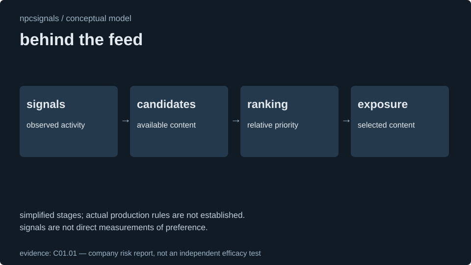

# behind the feed

a feed is not a catalogue. a catalogue lists what exists; a feed selects what becomes visible. recommendation systems can use viewing behaviour and interactions to rank candidates. the exact production weights, however, are not available in our archive.

tiktok's 2025 risk assessment describes concentrated content and dispersion techniques. this establishes the company's description of its safeguards, not their independent effectiveness. research on watch-time prediction offers a useful explanation of how viewing duration can be influenced by video length and user habits. a published engineering method is not evidence that the same method operates in the european feed.

consider two people opening the same application. they may encounter different material even when neither explicitly searches for it. selection, ranking and the available supply all matter. to isolate ranking, a researcher would need to observe the candidates available to the system as well as the items actually delivered.

our investigation therefore begins with a distinction between the documented mechanism and the unknown implementation. we do not claim to have reverse-engineered tiktok.

## from inventory to individual exposure

imagine a library containing a million books. the catalogue is the inventory; the display at the entrance is a selection. a personalized display changes according to the visitor. this analogy helps distinguish the existence of content from its distribution. it does not describe the exact architecture of tiktok's software.

selection may involve eligibility rules before ranking takes place. a public video is not necessarily eligible for recommendation. a video eligible for recommendation is not necessarily shown to a particular person. even a displayed video may be skipped before its message is understood. each step has a different denominator, and a measurement at one step cannot automatically describe another.

## the company's description

the archived 2025 risk assessment describes dispersion techniques, keyword filtering and feed refresh. these are relevant safeguards because they address different aspects of exposure: concentration, unwanted topics and accumulated personalization. the document is a company statement, not an independent experiment. the archived report is cited in [sources and source notes](../SOURCES.md). see printed page 21, C01.01 and F01 in the evidence register.

## what would establish effectiveness?

a test would compare equivalent observation windows, record which controls were applied and distinguish new content from repeated items. it would also need a baseline against which the change could be assessed. the existence of a setting is not enough to establish the size or duration of its effect. the next two chapters examine these distinctions.

---

[reader index](../START_HERE.md) · [evidence register](../evidence_register.csv) · [source notes](../SOURCES.md)

