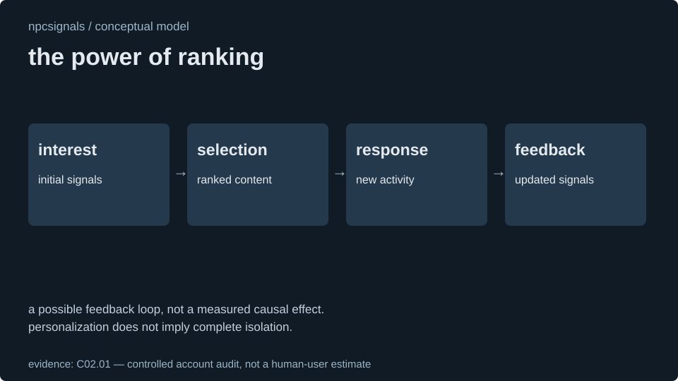

# the power of ranking

personalization can make a topic more prominent without making other topics disappear. the relevant question is how much exposure changes relative to a meaningful comparison.

baumann and colleagues report topic concentration in controlled automated-account experiments. the published article reports results from 42 runs. automated accounts do not reproduce the motivations or habits of human viewers. a missing neutral comparison also limits attribution.

ranking is only one explanation for concentration. the number of creators, their output, popularity and the user's choices can change the material available for recommendation. a convincing test would hold these factors as constant as possible, use independent accounts as experimental units and compare fixed observation windows.

we distinguish the proportion of recommended items belonging to a topic from the increase in that proportion. neither is a measure of psychological isolation. diversity of hashtags is also not necessarily diversity of viewpoints.

## a controlled experiment

[baumann and colleagues](https://doi.org/10.1140/epjds/s13688-026-00629-2) report 42 experimental runs, divided between gaming, food and combined interests. they report aligned content shares of 67.4%, 52.3% and 67.2%, respectively. these figures are checked against figure 3 (C02.01); the raw analysis has not been reproduced.

the remaining shares are equally important: the observed feeds were not entirely confined to the assigned interests. a share of 67.4% does not mean an increase of 67.4 percentage points. without a suitable reference share, the magnitude of an increase cannot be calculated from that figure alone.

## when does concentration begin?

figure 4 reports statistical change points at approximately 66, 140 and 93 videos for the respective conditions (C02.02). a change point is an estimate derived from observed data. it is not a known internal threshold at which the platform switches modes. the missing neutral control and combined engagement signals limit interpretation. the study compares later exposures with initial or alternative interest conditions, but these do not substitute for a matched neutral control across all runs. The figures are published estimates; our team has not recalculated them from raw data.

## measuring concentration

a researcher can count topic shares within fixed windows, or measure diversity across categories. a larger number of distinct hashtags may simply reflect a longer observation window. comparing equally sized windows and reporting uncertainty would make the result easier to interpret. a diversity measure must also specify whether it describes topics, creators, political positions or something else. these are not interchangeable.

---

[reader index](../START_HERE.md) · [evidence register](../evidence_register.csv) · [source notes](../SOURCES.md)

