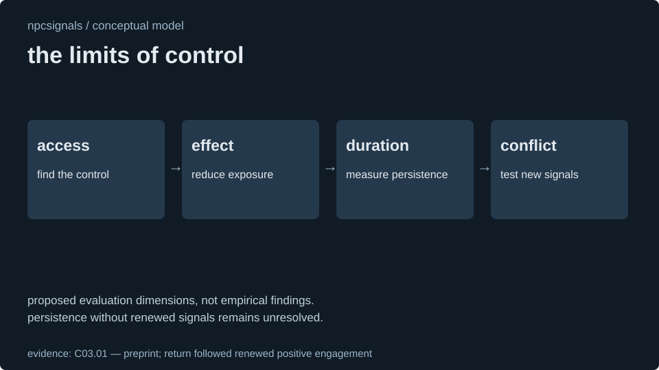

# the limits of control

a control can exist without being easy to find or effective over time. tiktok describes keyword filtering, feed refresh and explanations among its safeguards. the archived risk assessment supports the existence of these descriptions.

negative feedback is not necessarily ineffective. the kaplan study reports experiments in which negative feedback reduced topic exposure. renewed positive viewing may reverse that reduction. this is not the same as a spontaneous return of unwanted material when the user supplies no new positive signals.

we propose five separate measurements: immediate reduction, persistence without new signals, conflicting signals, return after renewed interest and the effort required to correct the feed. these are proposed tests, not results.

an audit of whether a feature is available and an experiment measuring its effect answer different questions. both matter. neither alone establishes whether a user has meaningful control in everyday use.

## feedback is not a single signal

skipping a video and explicitly marking it as unwanted are different actions. a skip may reflect lack of time, lack of interest or a decision already made after reading a caption. explicit negative feedback is a clearer instruction, but its implementation and weight are not visible to the user.

[kaplan and colleagues](https://arxiv.org/abs/2605.10690) report a controlled audit of TikTok’s mobile app using accounts the researchers controlled. The paper is an arXiv preprint, not an independently replicated result. It studies cooking, fitness, and sports-betting topics through cloned account histories. Across the tested conditions, both skipping and selecting “Not Interested” reduced the amount of topic material shown; the explicit control was often, but not always, more effective. The authors also note that the control is tucked into a share menu or long-press interface. We do not generalize their account-level results to every user or every topic.

## persistence and conflicting instructions

In the paper’s cooking comparison, topic videos fell from 30.5% of the feed under continued viewing to 16% after implicit negative signaling and 4.75% after explicit “Not Interested” signaling. The authors report 47.5% and 84.4% decreases against the continued-viewing condition. These are source-reported proportions from their controlled setup, not estimates for the average TikTok user.

The paper’s “relapse” phase deliberately changed the experimental accounts back to watching videos about the topic after they had signaled disinterest. In that condition, topic material often returned and could again dominate the feed. This is evidence about a renewed positive engagement signal. It does not demonstrate that the feed spontaneously returned to the topic while the account remained neutral or continued signaling disinterest. The experiment’s sequence, use of emulators, small number of repeated runs, and three selected topics limit the reach of the result.

we would measure correction burden as the number of actions and elapsed time required to achieve a defined reduction, not merely whether a button exists. a user who needs to repeat an instruction frequently may experience a different degree of practical control from someone who obtains a durable result. this is a proposed measurement, not a finding about current tiktok users.

---

[reader index](../START_HERE.md) · [evidence register](../evidence_register.csv) · [source notes](../SOURCES.md)

