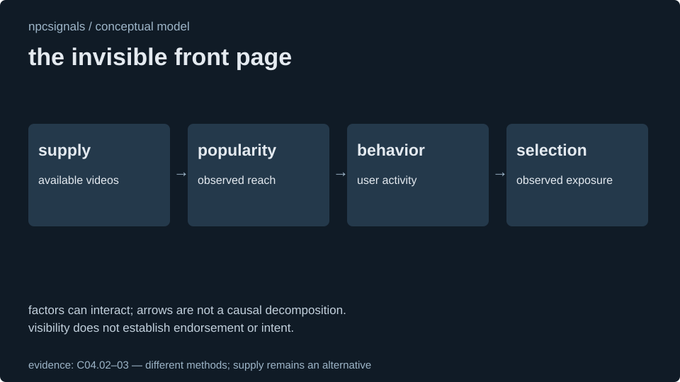

# the invisible front page

political information can reach people without a deliberate visit to a news outlet. this makes the composition of a feed a relevant research question, but political visibility is not political endorsement.

american automated-account studies and german viewing-history studies provide different kinds of evidence. one observes recommendations under experimental conditions; the other observes what participating people viewed. neither can automatically represent every european user.

a party may appear frequently because its own accounts publish frequently, because other creators discuss it, or because viewers seek it out. these mechanisms can coexist with ranking effects. a count of mentions cannot tell us whether the material is supportive or critical.

political visibility is shaped by the content people and organizations make, the size and structure of creator networks, user behavior, and recommendation. The studies below measure different parts of that system. None establishes an election outcome or intentional political manipulation.

## three different views of political exposure

an [american automated-account study](https://doi.org/10.1038/s41586-026-10447-1) reported controlled TikTok accounts across three states during the 2024 presidential election. Its results are geographically and temporally bounded and depend on which runs passed the authors’ inclusion rules. It cannot be generalized automatically to Europe or to ordinary users.

in germany, [tjaden and colleagues](https://doi.org/10.1080/10584609.2026.2733320) report a final published sock-puppet audit of 118 accounts and 266,161 videos across the 2024 regional and 2025 federal elections. An earlier preprint described 78 accounts and 561,000 videos. These are different versions of the same research project, not independent replications. The final paper reports that political material comprised about 5–7% of non-political feeds in its sample and that AfD-related content was more visible than other parties’ content. Its own analysis points to more accounts and more viral videos as plausible supply-side explanations; it does not directly measure the complete pool of available videos or isolate a ranking effect.

[wedel and colleagues](https://doi.org/10.34669/wi.wjds/7.2.1) analyzed donated watch histories from 612 participants during the 2025 federal election. They report that political videos made up 6.6% of watched videos after accounting for overlapping categories, and that partisan content aligned with reported vote choice in pooled models. The study is observational, its data-donation sample is not representative, and it does not separate recommendation from users’ accumulated choices. Only 543 participants entered the inferential models. The authors identify creator supply, informal supporter pages, classification limits, and engagement as alternative mechanisms. Their interpretation is that the observed prominence is more consistent with discourse and supply than with asymmetric algorithmic amplification; that interpretation is not a causal estimate.

## supply, selection and interpretation

if one political group produces more videos, a larger share of exposure could arise without preferential ranking. if a party is discussed frequently by its opponents, its visibility could increase without any increase in support. distinguishing these possibilities requires a suitable candidate inventory, content classification and a design capable of separating supply from selection.

[hagar and diakopoulos](https://doi.org/10.1177/14614448231192964) report historical american findings on limited proactive news distribution (C04.05). it raises a separate question: not only which political material appears, but whether reliable news appears at all. it cannot establish present european distribution.

we exclude the disputed weekly exposure arithmetic from the german audit. The early and final paper versions are recorded separately in the research record, and their counts are not added together. The final paper’s classifier validation was stronger for identifying political material than for assigning party support; party-support F1 scores varied by party, from 0.54 to 0.83. That uncertainty narrows claims about whether a video supported a party. These studies provide observations about measured feeds and watch histories, but they are not independent replications of one causal effect.

---

[reader index](../START_HERE.md) · [evidence register](../evidence_register.csv) · [source notes](../SOURCES.md)

### experimental coverage

ibrahim et al. report that 323 of 567 runs met inclusion criteria. the minimum observation threshold changed from 500 to 150, and neutral accounts were limited to georgia. see C04.01 and the [original methods](https://doi.org/10.1038/s41586-026-10447-1).

### news exposure

[hagar and diakopoulos](https://doi.org/10.1177/14614448231192964) report little proactive news exposure and no increase in credible news exposure following simulated interest signals (C04.05, publisher abstract). the historical us setting limits transfer to current european feeds.
