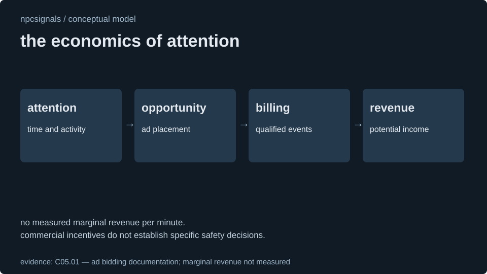

# the economics of attention

attention can have commercial value because advertising opportunities depend partly on people using a service. that does not mean every additional minute produces revenue, or that every safety decision is made to maximize time spent.

a Kentucky consumer-protection complaint alleges that platform design and public safety statements harmed young users. In a 20 February 2026 procedural order, the court denied TikTok’s motion to dismiss. At that stage, the court treated pleaded facts as true for purposes of deciding whether the claims could proceed; it did not decide whether the allegations or quoted internal materials were true. This is evidence of a procedural ruling, not a finding of misconduct. We have not authenticated the underlying internal documents or reconciled their provenance with documents mentioned in other cases.

safety and commercial incentives may also align: trust, advertiser confidence and long-term retention can benefit from effective protection. we would need dated internal decisions, alternatives considered and evidence of implementation to determine which considerations prevailed in a particular case.

american legal obligations are not interchangeable with european ones. the investigation examines decision mechanisms rather than assigning motives to individuals.

## the advertising mechanism

advertising can be purchased according to impressions, qualified views or clicks, with optimization toward particular outcomes. [tiktok's bidding documentation](https://ads.tiktok.com/resources/help/article/bidding-methods) documents these distinctions (C05.01). a user spending more time in the application may create more opportunities for advertising, but the number of opportunities, actual advertisements delivered, prices and advertiser demand are not constant.

## an imperfect measure of interest

[bytedance research on watch-time prediction](https://doi.org/10.1609/aaai.v40i18.38555) is indexed as C05.02. the published abstract describes an approach to correcting biases associated with duration, popularity and viewing habits. consider a viewer watching twenty seconds of a sixty-second video and fifteen seconds of a fifteen-second video. raw time favours the first, completion rate favours the second. neither establishes what the viewer actually prefers. the example is synthetic and does not reproduce the published model.

## examining decisions rather than incentives alone

an incentive creates a reason to investigate, not proof of a decision. the [Kentucky procedural order](https://www.ag.ky.gov/Press%20Release%20Attachments/2026.02.20%20Order%20Denying%20MTD.pdf) is listed under C05.03. The underlying internal documents and their context remain necessary for independent verification. a decision record would need to establish the proposal, the competing objectives, the authority responsible, the actual implementation and the resulting measurements. without that chain, the economic mechanism cannot establish a particular safety failure.

---

[reader index](../START_HERE.md) · [evidence register](../evidence_register.csv) · [source notes](../SOURCES.md)

### source boundaries

tiktok documents four advertising bidding methods (C05.01). bytedance researchers report testing a watch-time correction method (C05.02); its deployment in tiktok’s european service is not established.
