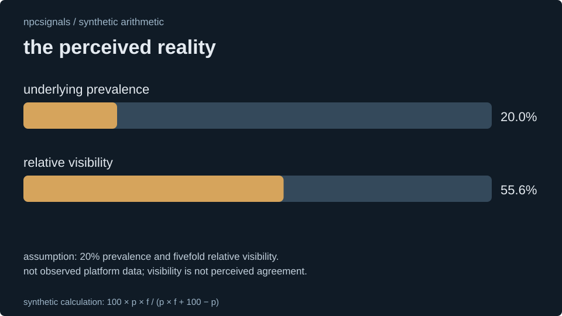

# the perceived reality

what people encounter repeatedly may influence what they believe is common. visibility is not the same as prevalence in the population, and perceived prevalence is not the same as personal agreement.

network research on the majority illusion provides a model for understanding how local exposure can differ from the wider population. in a synthetic example, if a group represents twenty percent of a population but receives five times the exposure weight of everyone else, its expected share of visible material becomes about fifty-six percent. this is arithmetic, not measured tiktok data.

experimental research on other platforms offers mixed evidence about changes in political attitudes. changes in exposure, emotion, perceived norms and durable behaviour must be measured separately. the archive does not establish a causal effect of tiktok's european ranking system on any of these outcomes.

we retain studies reporting limited effects as well as studies reporting measurable effects. detailed estimates from the original science study are excluded because the correction texts could not be fully checked.

## from exposure to perception

[lerman, yan and wu](https://doi.org/10.1371/journal.pone.0147617) provide a statistical model of the majority illusion (C06.01). local observations can differ from population prevalence because connections are unevenly distributed. personalized ranking is therefore not the only possible source of distorted visibility.

our illustration uses a relative exposure weight: if prevalence is p and the group's weight is f, its visible share is pf divided by pf plus the remaining population share. with p = 0.2 and f = 5, the result is 0.556. the model assumes homogeneous weights within each group. it says nothing about whether viewers notice, believe or endorse the material.

## emotions and social norms

[brady and colleagues](https://doi.org/10.1038/s41562-023-01582-0) report a Twitter field survey and preregistered behavioural experiments. Observers inferred stronger moral outrage from posts than the authors of those posts reported feeling. Experimental results linked overperception of individuals’ outrage with overestimates of collective outrage and hostile communication norms. This concerns interpretation of messages and perceived norms; it does not show that TikTok recommendations cause outrage or change political beliefs. We verified the article record and abstract, but did not independently reproduce its analyses.

another [ranking experiment on bluesky](https://doi.org/10.1038/s41586-026-10536-1) is indexed in C06.03. the published abstract and research briefing describe an eight-week randomized experiment with 2,000 participants and report improved accuracy of some perceived norms under alternative ranking. this is a promising counterpoint to the idea that all recommendation systems necessarily produce the same effects. the experiment is not evidence of tiktok's european production system.

## exposure is not a vote

research on other services cautions against assuming that exposure changes produce large or durable attitude changes. Experiments on X and on a custom video-recommendation interface report changes in what people saw or chose to watch, while reporting limited or mixed short-term political attitude effects. Those platforms, treatments, samples, and time windows differ from TikTok’s European service.

Guess and colleagues’ 2023 *Science* article has two subsequent correction notices, dated 2024 and 2026. The notices’ records and relationship to the article are confirmed, but the publisher’s correction texts were not fully accessible for this review. We therefore do not use detailed estimates from that article as support for a public conclusion. A correction notice is not itself evidence that an entire study is invalid.

---

[reader index](../START_HERE.md) · [evidence register](../evidence_register.csv) · [source notes](../SOURCES.md)

