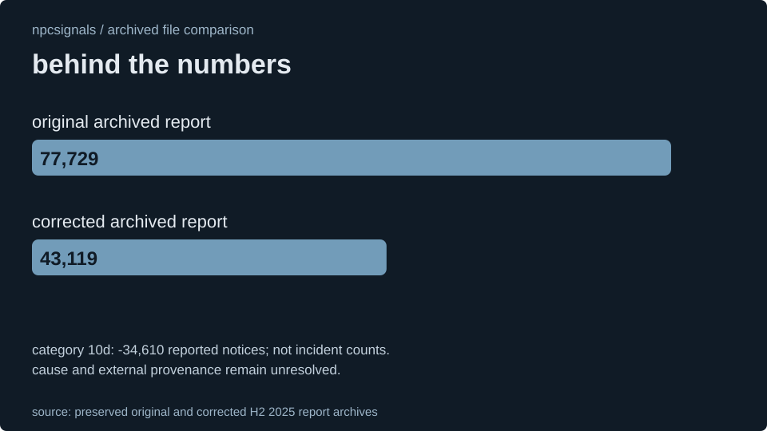

# behind the numbers

transparency reports are evidence of what a platform reports. they are not a direct measurement of every event occurring on the platform.

the preserved original and corrected report archives differ in category 10d: 77,729 versus 43,119 reported notices, a difference of 34,610. Category 13b changes from blank to 34,575. The company’s correction notice says specific data points in these two categories were updated. These are reported notice counts, not terrorist incidents, unique videos, or unique people. A blank is not a numerical zero.

a correction can be consistent with a functioning quality-control process. it can also reveal a weakness in earlier reporting. neither explanation establishes intent. the underlying cause and independent provenance of the two archived versions remain open.

our technical appendix preserves the original files and earlier comparison scripts. missing values must not be silently treated as zero; a comparison must report both added and removed fields and test its row keys. until those checks are complete, we do not infer a transfer of notices between categories.

## the comparison in detail

our [machine-readable comparison](../reproducibility/notices_comparison.json) records 91 data rows in each selected CSV. Each file has 26 physical columns. The original has 26 unique headers; the corrected file has 22 because four headers appear twice. The duplicated column contents agree row by row, so the revised comparison checks equality before reducing to unique fields. Category 10d’s identifier maps to terrorist content, while the earlier description field said “consumer-related offences”; the corrected description says “Terrorist Content.” The 13b row likewise changes from blank description and values to a populated unsafe-products row. These are field-level changes that should be read alongside the numerical differences.

category 13b contains a newly populated value of 34,575 notices. a blank in the earlier file is not a reported zero. the numeric child subtotals differ from their unchanged parent totals by minus 34,610 and plus 34,575 for categories 10 and 13 respectively (F07.04). the combined arithmetic difference is minus 35. This does not demonstrate a one-for-one transfer. The available definitions do not establish that every parent must equal a sum of displayed child rows, so the comparison does not infer additivity or a causal relationship between categories.

## what a checksum establishes

a checksum can demonstrate that a preserved file has not changed since its checksum was calculated. it cannot prove who originally produced the file or whether the reported figures correspond to underlying events. external provenance remains unresolved. the comparison also depends on the ordering of parent and child rows. a future file with reordered categories requires a renewed key validation.

this is why we preserve both versions, the scripts and the results. a reader can inspect the calculation without accepting an explanation for the correction.

---

[reader index](../START_HERE.md) · [evidence register](../evidence_register.csv) · [source notes](../SOURCES.md)

## a structural correction

both archived csv versions contain 26 physical columns. the corrected file has only 22 distinct column names, because four contextual headers are duplicated. the duplicated values agree in every row. the revised comparison confirms 16 changed common-field values across two rows. numeric child subtotals no longer match the unchanged parent totals in two categories; whether these totals are required to be additive remains unresolved. see [structural review](../reproducibility/README.md) and [comparison results](../reproducibility/notices_comparison.json).

