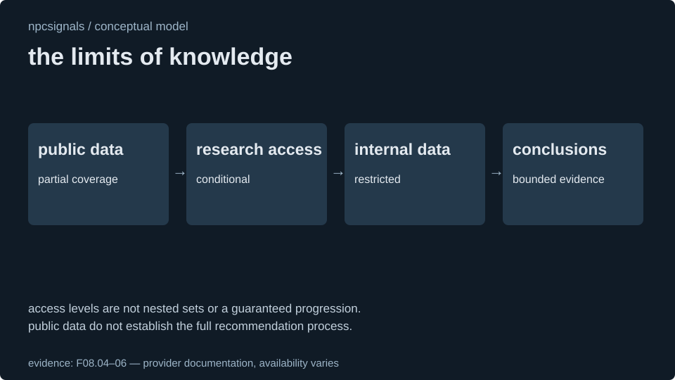

# the limits of knowledge

oversight is part of the architecture of influence. the digital services act provides mechanisms for risk assessment, mitigation, audits, transparency and researcher access. the archived kpmg report addresses specified compliance requirements, not every aspect of the recommendation system.

the Commission’s public register records formal proceedings and preliminary findings, including a 6 November 2026 preliminary finding about repetitive exposure in the For You feed. These are not final infringement decisions. TikTok has also accepted binding commitments in separate matters, including the 2024 TikTok Lite rewards case and 2025 advertising repository case. A binding commitment is legally distinct from a finding that a safeguard works in practice. Public research data can support content analysis but do not necessarily reveal individual recommendation decisions or internal ranking weights.

Norway is a separate legal comparison. Nkom stated on 17 November 2026 that the DSA had not yet been incorporated into the EEA Agreement or Norwegian law. EU supervision of TikTok therefore cannot be described as identical Norwegian enforcement. This legal boundary says nothing by itself about product features in the Norwegian app.

this investigation does not establish intentional political manipulation, changed election outcomes or deliberate misreporting. it identifies mechanisms, documented claims and testable questions. the remaining uncertainty is part of the result, not a gap to fill with speculation.

## who can examine the system?

the commission's [supervision register](https://digital-strategy.ec.europa.eu/en/policies/list-designated-vlops-and-vloses) lists tiktok as a very large online platform. it records binding commitments in 2024 and 2025 and preliminary findings in 2026. preliminary findings are not final judgments.

## the norwegian boundary

[nkom's statement of 17 november 2026](https://nkom.no/internett/internettbaserte-plattformer/digital-services-act-dsa) confirms that the dsa has not yet been incorporated into the eea agreement or norwegian law. this does not establish differences in the app itself.

## access is not exposure

TikTok’s Research API codebook includes public videos that are not eligible for For You recommendations. Public-content access therefore cannot substitute for a log of individual feed exposures. TikTok’s Research Tools are separate from statutory access under DSA Article 40; a provider API’s availability does not establish access to individual recommendation decisions. Eligibility and approval are distinct, and NPCsignals has not obtained research access.

## oversight is not a single verdict

the [digital services act](https://eur-lex.europa.eu/eli/reg/2022/2065/oj/eng) and the [2025 delegated regulation on researcher access](https://eur-lex.europa.eu/eli/reg_del/2025/2050/oj/eng) distinguish risk assessment, mitigation, independent audits and access to data. these mechanisms answer different questions. an audit assesses specified requirements during a defined period. a regulator may examine a different question or a later period. a preliminary finding does not constitute a final infringement decision.

KPMG’s 2025 audit covered 1 July 2024 to 30 June 2025 and issued a qualified negative overall opinion under the DSA audit framework, after reporting negative conclusions for some specified requirements. The report also said it could not audit the Article 34 and 35 systemic-risk requirements because the Commission’s related proceedings were confidential. That disclaimer is not proof that every recommender mechanism failed. The provider’s 2024 and 2025 implementation reports describe measures and future milestones; those are provider reports, not independent tests that the measures later worked. The audit report discloses that KPMG also provides other permitted professional services to TikTok. The published scope, sampling, exceptions, and this relationship are summarized in [sources and source notes](../SOURCES.md).

## the research boundary

public content data may be useful for studying supply, but the provider's codebook describes a wider set than recommendation-eligible material (F08.04). an exposure log would answer a different question. neither necessarily reveals internal ranking weights or the counterfactual items that would have appeared under another model.

we have not obtained research access or run a live platform experiment. eligibility for independent access is not approval. a future pilot would require a legal and ethical assessment, a valid comparison group, a defined observation window and a plan for handling missing data and account failures.

## what remains unknown

we cannot infer the intent of a decision-maker from an unexplained distribution, or deliberate misreporting from a correction. the investigation documents mechanisms and identifies measurable questions. the public record does not provide a complete causal explanation of the feed. that limitation is a substantive result, not an invitation to speculate.

---

[reader index](../START_HERE.md) · [evidence register](../evidence_register.csv) · [source notes](../SOURCES.md)

