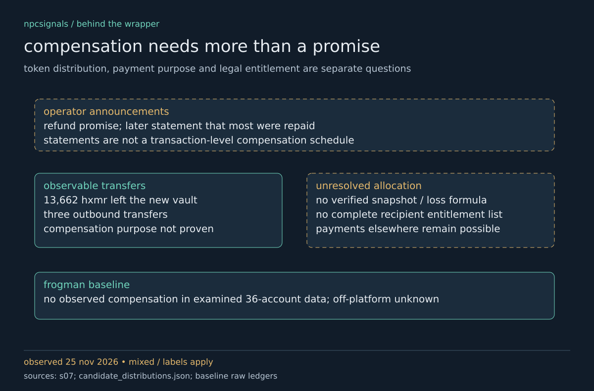

# compensation: promises, transfers and obligations

original public operator statements are preserved in the inherited checkpoint. the 20 november statement promises refunds to market makers. the 23 november statement says most affected people were repaid and some larger holders agreed to payment plans. both are confirmed as statements; their accounting completeness is not independently established.

no complete incident-specific eligibility policy, snapshot timestamp, pre-incident versus crash-buyer formula, exclusions, claims deadline, recipient schedule or outstanding-payment statement was obtained. ordinary swap refunds and general compliance rules are not silently treated as the loss-compensation program. in particular, an address's presence in the frogman archive does not establish inclusion, exclusion, legal entitlement or ineligibility.

## actual observable transfers

the hxmr vault ledger records 10 hxmr and 5,000 hxmr to `0x19c46f4bb8f50a74e4cc14d97ac070a0d8bc5221`, plus 8,652 hxmr to `0x4c6d679eac539bf7c5a0b7ebd8949ae93b1e5ee9`. these are **13,662 hxmr in three outgoing transfers**, not a verified compensation total. the latter address is also named by the external incident analysis as a large buyer; that role remains attributed unless independently reconstructed.

the two recipient ledgers were fetched, yielding 192 and 694 records. their transfers are preserved as candidate distribution evidence, not automatically labeled refunds. the 694-record result reaches the conservative 500-record warning threshold; exact exhaustive recipient coverage is not asserted. there is no authenticated mapping of these entries to loss calculations, actual beneficial recipients or native-monero settlement. one ordinary transfer cannot demonstrate payment of a claim.

funding sources established: genesis hxmr inventory and specific on-platform transfers. native xmr funding or external personal wealth behind compensation is unresolved. source token distributions and downstream payouts must not be added as distinct amounts paid.

## frogman boundary

the preserved 36-account observations have no new ledger event or hxmr credit through 25 november 04:28:08.797 utc. no compensation to those original accounts is demonstrated. payments to different addresses or chains, private agreements and native-monero payments remain unverified. a lack of incoming entries at the original addresses does not prove no compensation anywhere.

[candidate distribution records](evidence/candidate_distributions.json) retain exact hashes, timestamps and endpoints. actual payment purpose and recipient rights remain UNRESOLVED. no involved party was contacted.

