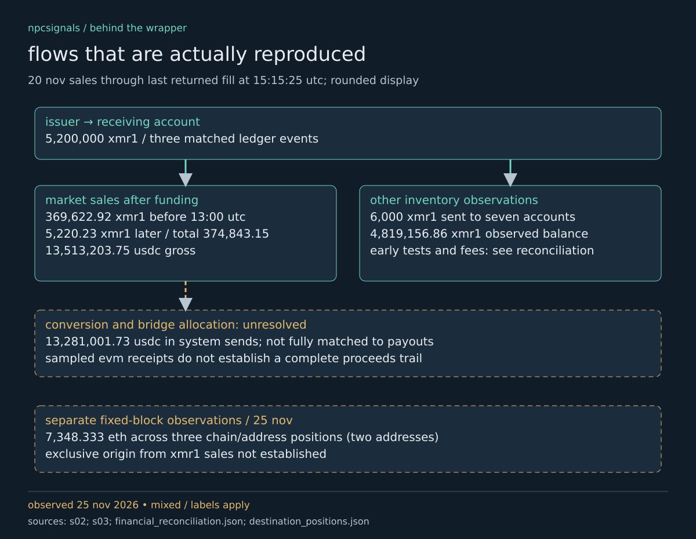
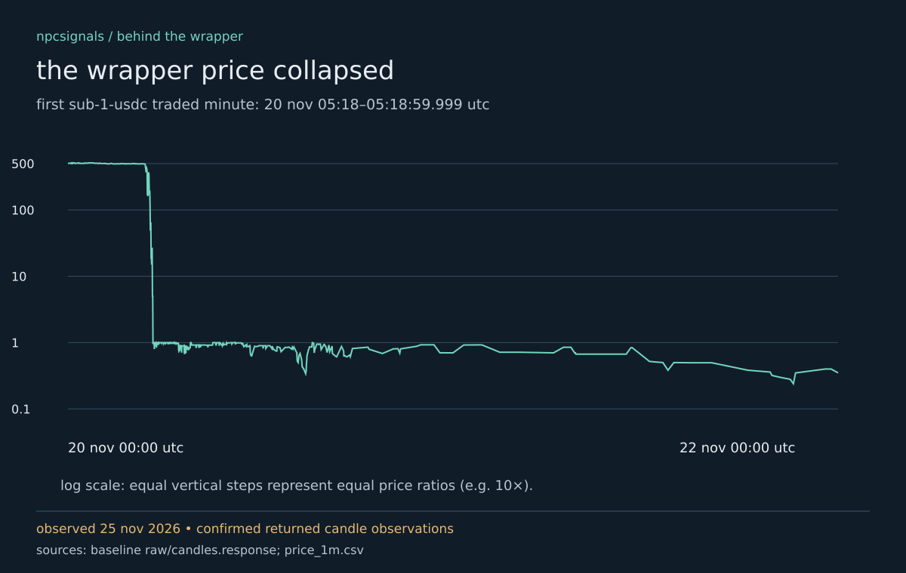

# november financial reconciliation

first-party api observations are CONFIRMED within their recorded scope; protocol-wide consensus replay is not asserted.

## issuer inventory and token sales

three issuer transfers total **5,200,000 xmr1**. seller ledger records also show **6,000 xmr1** sent to seven distinct accounts. transfers alone do not prove native-monero redemption.

raw fill pagination returns 2,000 / 2,000 / 715 rows, with overlapping timestamps deduplicated by hash and trade id: **4,594 unique fills across all markets**. an aggregated query independently cross-checks quantities but its rounded average prices are not used for final proceeds arithmetic.

| scope | xmr1 sold | gross usdc | usdc fees | net usdc |
|---|---:|---:|---:|---:|
| all returned xmr1 sells, including early tests | 374843.19 | 13513223.613896 | 8112.82930922 | 13505110.78458678 |
| sales after first issuer funding | 374843.15 | 13513203.749996 | 8112.81099269 | 13505090.93900331 |
| after funding, through 13:00 utc on 20 nov | 369622.92 | 13507983.519996 | 8110.80642437 | 13499872.71357163 |

the external 369,623-xmr1 / approximately 13.51m-usdc figures agree with rounded primary observations at its stated cutoff. later executions through 15:15:25.631 utc explain the larger full-window total. tests before issuer funding bought 0.05 xmr1 and sold 0.04; these are not silently counted as incident inventory sales. comparisons also need to distinguish sales quantity from number of buyers or execution fills. this archive has not independently enumerated all opposite-side buyer identities.

## quantity conservation

5,200,000 issuer input + 0.05 earlier buys − 6,000 side transfers − 374,843.19 all returned sells − 0.00003358 xmr1 buy fees = **4,819,156.85996642 xmr1**. queried seller balance is **4,819,156.8599664196**. the **−0.0000000004 xmr1** residual is retained, not forced into an invented transaction. source precision/rounding or adjustments are not independently resolved.

eleven usdc ledger sends to the hypercore system destination total **13,281,001.7254710004 usdc**. a system transfer is not automatically the final arbitrum payout. conversion, receipt fees, other market activity and opening balances must be reconciled before equating all token-sale proceeds to native eth. the full 7,467-eth acquisition claim and all seven bridge routes remain only partially reproduced; see sampled successful primary transactions in `evm_examples.json`. no complete flow claim is made from matching amounts or time alone.

## current native eth positions

- ethereum / `0x1464dacaceb0d511f9964cdac5eba50ea42220bf`: **1974.556474143708189012 eth**, block 26489952 (2026-11-25T04:57:47+00:00).
- ethereum / `0xf32d7842611a5d63b875075dadd19c55f3f1dc59`: **4835.669594723330818717 eth**, block 26489952 (2026-11-25T04:57:47+00:00).
- arbitrum / `0x1464dacaceb0d511f9964cdac5eba50ea42220bf`: **538.106931436858404165 eth**, block 527325389 (2026-11-25T04:58:16+00:00).

sum: **7348.333000303897411894 eth** across three chain/address positions, comprising two literal addresses. this independently reproduces the rounded approximately 7,348-eth observation at new dated blocks. it is not a reserve, freeze, recovery or proof all these coins came exclusively from xmr1 sales.

source quantities, token-sale proceeds, system sends, bridge inputs and destination balances are successive representations and must not be added together. sampled receipts and containing blocks are independently checked for successful execution, hash agreement and inclusion. no independent decoding of every bridge message or all source/destination settlements was completed.

[financial json](evidence/financial_reconciliation.json) · [raw paginated fills](evidence/seller_raw_pagination.json) · [sampled evm examples](evidence/evm_examples.json) · [positions](evidence/destination_positions.json).

