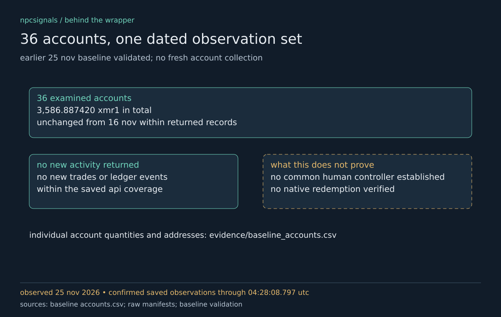
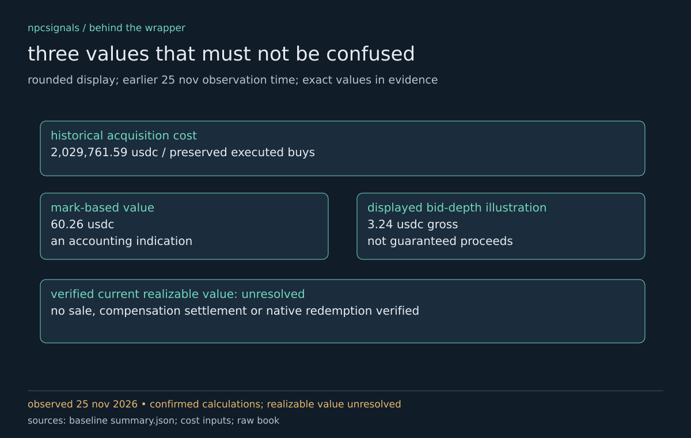

# frogman and wagyu are distinct incidents

the original source package was retrieved and checked against its exact saved sha256 and every one of its 508 checksum entries. its 36 addresses and 3,586.887420 xmr1 total were independently recomputed from saved rows. historical buy costs were recomputed from 35 original account costs plus the separate account's fills, equaling 2,029,761.5937 usdc. no completed account collection was repeated.

**carried cutoff: 2026-11-25T04:28:08.797000+00:00**. this is not a new later balance check. the source response windows and spot-state retrieval times remain in the published baseline evidence subset.

observable link: the examined accounts purchased and held the exact xmr1 token affected by the november event. neither a holding nor use of a shared bridge identifies a person, establishes control of the issuer/seller, or connects the october wallet access method to the later incident. the original privacy cash withdrawal-provenance gap remains open.

no new fills or ledger events were returned in that saved check; no native xmr redemption or compensation was independently established. current operator documentation changes the stated treatment of the old token, not the historical account evidence.

other incident comparisons from the baseline were limited to published-page address references. no overlap there is not proof that complete case inventories are disjoint. no new speculative identity investigation was conducted.

historical acquisition cost: **2,029,761.5937 usdc**. dated mark-price value: **60.2597086560 usdc**. dated static bid-depth gross illustration: **3.238959340260 usdc**, before fees and movement. verified current realizable value: **UNRESOLVED**. none is automatically a legally determined victim loss or recovered amount.

[original frogman research](../frogman-wallet-drain/START_HERE.md) · [publication evidence boundaries](PUBLICATION_NOTES.md).
