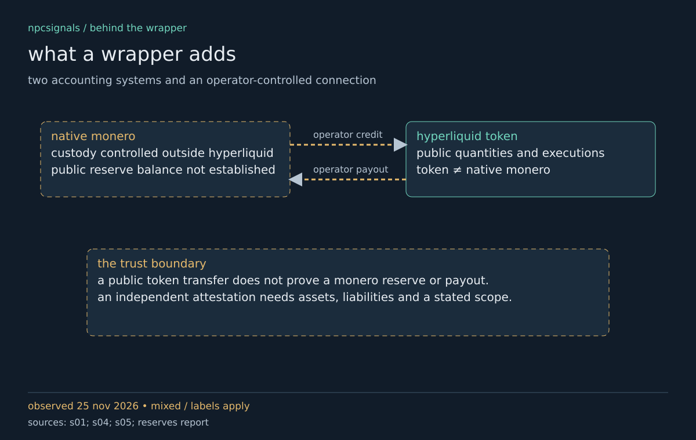
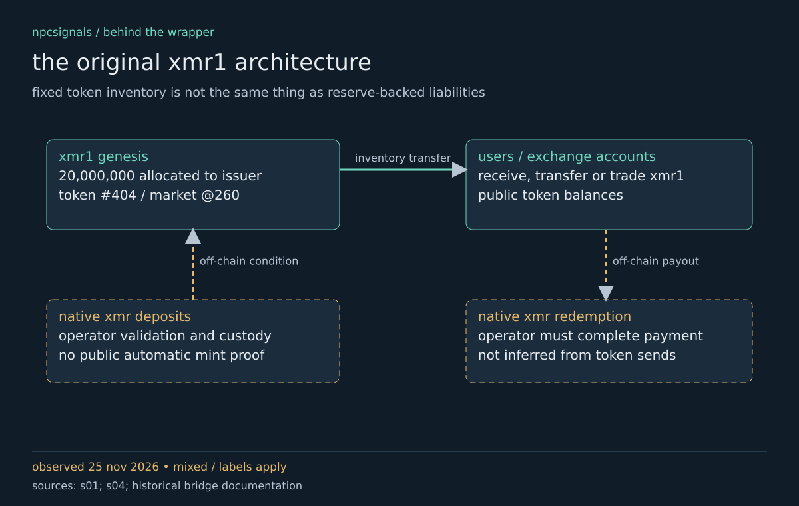

# reserves, liabilities and redemption

historical bridge documentation describes depositing native monero and receiving xmr1, or returning xmr1 to receive native monero. current documentation describes hxmr instead. those are operator product statements, not independent proof every native deposit was received, each issued unit was backed, or every withdrawal completed.

## five separate questions

| question | observable evidence | present conclusion |
|---|---|---|
| who holds tokens? | hyperliquid balances and ledger entries | selected account and issuer quantities CONFIRMED |
| what is their market price? | fills, candles and order book | dated observations CONFIRMED |
| what native reserves exist? | custody disclosure, scoped attestation, view-key evidence | UNRESOLVED |
| what entitlement does a holder have? | applicable terms and incident-specific commitments | operator statements preserved; legal enforceability NOT ASSESSED |
| was a native payment made? | payment proof tying intended recipient, amount and transaction | not independently verified for the frogman set |

inventory is not reserves. twenty million preallocated tokens do not imply twenty million deposited xmr, and concentrated inventory does not prove inadequate backing. a reserve asset total alone would also fail to prove solvency without a corresponding liability statement and ownership/encumbrance scope.

monero conceals ordinary public sender, recipient and amount relationships. an outside observer cannot reconstruct reserve balances using an evm-style address explorer. independently scoped attestations or selective cryptographic disclosure could provide evidence, but none was obtained from the inspected material. failure to obtain such evidence is an evidence gap, not proof reserves are absent.

current native-bridge documentation says xmr1 was closed on 20 november, is no longer treated by the operator as a monero claim and is not accepted for new bridge orders. it separately directs legacy open orders to support. that does not establish a universal legal extinction of preexisting claims, automatic migration, or completion of compensation. hxmr acceptance is not evidence that xmr1 is interchangeable with hxmr.

no public reserve attestation, independent reserve/liability audit, complete native custody inventory or quantified outstanding xmr1 compensation liability was obtained. no report of native-monero redemption is upgraded merely because an account sent tokens to a busy service address.

