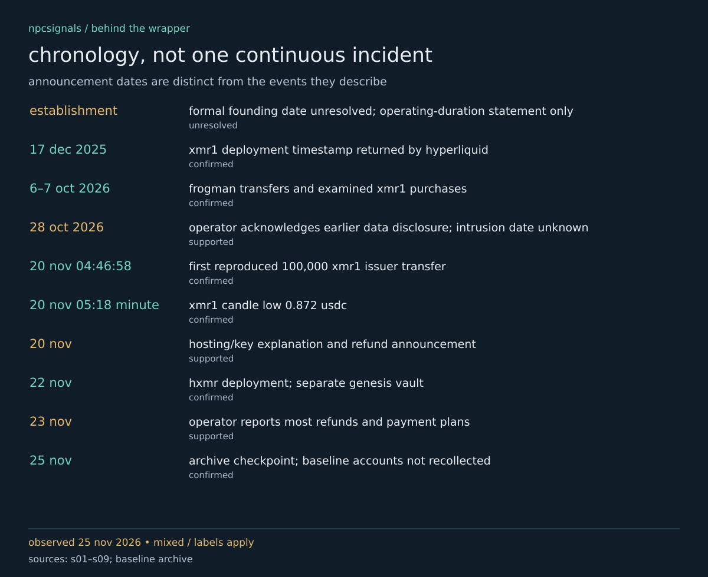

# historical timeline

event and announcement dates are intentionally separated. api deployment timestamps are preserved exactly; tokenDetails strings omit a timezone suffix, so their full representation is not silently rewritten as an independently authenticated utc event.

| event date | record/announcement date | observation | class / source |
|---|---|---|---|
| establishment unresolved | 28 oct 2026 | operator refers to about a year of operation; no formal founding date independently established | SUPPORTED duration statement / s07 |
| 17 dec 2025 | token details queried 25 nov 2026 | xmr1 deployTime 2025-12-17T12:20:01.569613623 | CONFIRMED returned metadata / s01 |
| 26 mar / 15 apr / 19 sep 2026 | 25 nov observation | tao1 / trx1 / zec1 returned deployment dates | CONFIRMED metadata / s01 |
| 6–7 oct 2026 | original frogman research | selected transfers, protocol routes and xmr1 holdings reproduced | CONFIRMED scoped research / s10 |
| intrusion time unknown | 28 oct 10:04 utc | operator acknowledges three months of data exposure | CONFIRMED statement; scope SUPPORTED / s07 |
| 20 nov 04:46:58.926 utc | 25 nov query | first 100,000 xmr1 issuer transfer | CONFIRMED first-party record / s02 |
| 20 nov 04:49:32.170 utc | 25 nov query | first returned sale after issuer funding | CONFIRMED fill / s03 |
| 20 nov 05:14:30.952 / 05:16:10.436 utc | 25 nov query | 100,000 and 5,000,000 xmr1 transfers | CONFIRMED first-party record / s02 |
| 20 nov 05:18 minute | earlier 25 nov checkpoint | first returned candle below 1 usdc | CONFIRMED candle interval / s10 |
| 20 nov 09:36 / 11:31 / 12:48 utc reported post times | 20 nov public posts | uncertainty, compensation pledge, then hosting explanation | statement provenance s07; causal explanation UNRESOLVED |
| host intrusion time unknown | 20 nov 11:08 utc media reproduction | provider/cert-is joint notice describes serious attack | SUPPORTED through reproduced notice / s08 |
| 20 nov | current documentation built 24 nov | xmr1 closure and no longer accepted as a monero claim | CONFIRMED operator position, not a legal ruling / s05 |
| 21 nov | current changelog | zec1 bridge closed | CONFIRMED published operator position / s05 |
| 22 nov | api queried 25 nov | hxmr deployment timestamp 2026-11-22T18:03:03.412341472 | CONFIRMED returned metadata / s01 |
| 23 nov | original public post | operator reports most refunds and plans for some large holders | CONFIRMED statement, distributions not wholly verified / s07 |
| 25 nov 04:28:08.797 utc | private checkpoint | 36 frogman-related accounts unchanged within examined histories | CONFIRMED saved observations / s10 |
| 25 nov approx 04:57–04:58 utc | current evm queries | three native eth positions reproduced at fixed blocks | CONFIRMED balances / s09 |

## early archived pages

the archive index and two returned bodies are preserved under s13. the 31 december 2025 capture displays the wagyu bridge interface describing native monero deposits and xmr1 credits to hypercore. the february 2025 response body does not supply attributable operating history. neither capture independently establishes a founding date. archived request urls and retrieval dates are preserved; no claim of a formal launch date is made.
