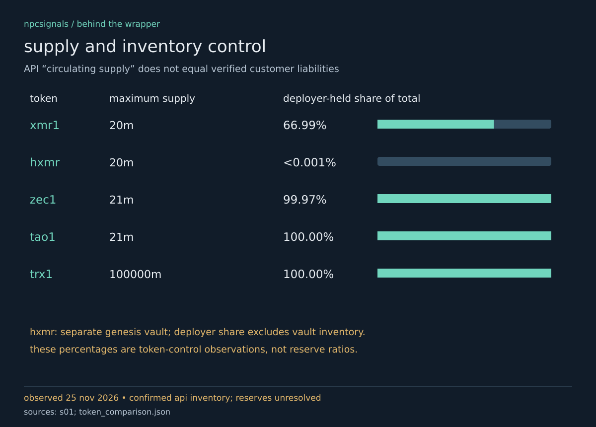
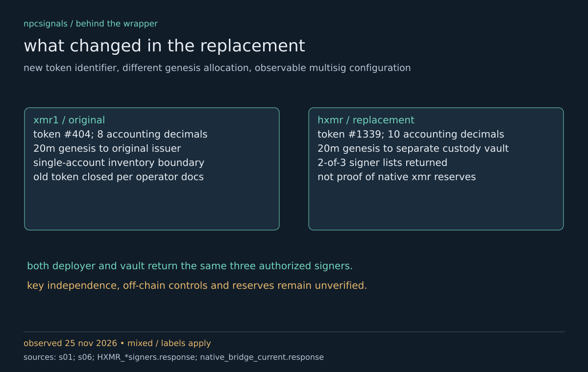

# token architecture and control

## original token

xmr1 is hyperliquid token 404, token id `0xbb2057659bd378d17e2e151bb04bdcaa`, market `@260` against usdc. returned genesis allocates 20 million to `0x207700bd207df757825f9193ef9c648c1c65e06a`. the name alone is insufficient identification because names need not be unique.

hip-1 is a capped token model with genesis supply and allocation. ordinary xmr1 bridge credits can therefore be inventory transfers rather than newly minted tokens. no public program or automatic mechanism binding each issued xmr1 unit to a cryptographically verified monero deposit was established. the native-asset validation and payout boundary remains operator-controlled.

inventory control, trading permission, deployer fee configuration and native reserve custody are different roles. native user-signed transfer rules are distinct from trading-agent permissions. no recovery of private signatures or historical key-custody audit was performed.

## observed token metadata and concentration

- `XMR1`: max 20000000.0; total 19999998.4035707116; api circulating 19999992.38049867; issuer inventory 13398815.44801162 (66.994083% of total).
- `HXMR`: max 20000000.0; total 19999999.9999989718; api circulating 19999999.9999989718; issuer inventory 2.6503633806 (0.000013% of total).
- `ZEC1`: max 21000000.0; total 20999999.9971618801; api circulating 20999999.9971618801; issuer inventory 20993996.7175443843 (99.971413% of total).
- `TAO1`: max 21000000.0; total 21000000.0; api circulating 21000000.0; issuer inventory 21000000.0 (100.000000% of total).
- `TRX1`: max 100000000000.0; total 100000000000.0; api circulating 100000000000.0; issuer inventory 99999898800.0 (99.999899% of total).

[all exact metadata, deployers and genesis allocations](evidence/token_comparison.json). these are current inventory observations, not pre-incident holdings. the external 93% pre-incident xmr1 issuer share is a dated external analysis and must not be substituted for today's approximately 67% issuer inventory.

token tickers do not substitute for identifiers. zec1, tao1 and trx1 reproduce the same deployer as xmr1. that confirms a shared public token-control account, not proof that every reserve, employee or server was shared. concentrated ownership is not evidence of insufficient reserves. the api circulating field includes far more than independently verified customer claims.

## hxmr comparison

hxmr is token 1339, id `0x700beac50c950503f401d218e52014e7`, market `@1193`; size decimals 5, accounting decimals 10. deployer `0x429c7679b01c8f27c4e38b2d04b176f13d2be9ba` differs from the xmr1 deployer. genesis allocated all 20 million hxmr to vault `0x3980feaade07f42cd5b93916996a4b1afdc113d9`.

both deployer and vault `userToMultiSigSigners` responses return threshold 2 and these three addresses:

- `0x4f04b7edd8e26b0fa5bd97b289ac2b62f95ce5fb`
- `0xb05f8bdac0bd5e9238fb2b9d022968b27938a3ef`
- `0xcee2023314ba49fec76d6d63d74c36c1b63418b5`

this directly supports current two-of-three account configuration. the more generic `userRole` response says `user` and is not a negative test for multisig; the specialized signer endpoint supplies the actual threshold evidence. signer identities, independence, recovery arrangements, hardware protections and off-chain custody are NOT ASSESSED. no claim that multisig proves reserves or eliminates compromise is made.

